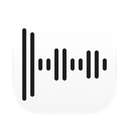

<picture><source media="(prefers-color-scheme: dark)" srcset="docs/icon-dark.png"></picture>

# TTS (Text to Speech) for Mac

Free, open source text to speech app for macOS. A text pasted into the window or a file dropped on it is read aloud in one of ten voices, and the speech can be saved as an MP3.

Apple silicon, macOS 13.3 or later. Interface in English, Ukrainian and Russian. Signed with a Developer ID and notarized by Apple.

## Install

Download `TTS.dmg` from [Releases](https://github.com/geragarazagh/tts/releases/latest), open it and drag `TTS.app` to Applications. Later versions arrive through Check for Updates.

Or with [Homebrew](https://brew.sh):

```sh
brew install geragarazagh/tap/tts
```

## Use

On first launch the window offers the voice model, 401 MB. Nothing is downloaded before Download is pressed.

A text is pasted or dropped as a file: plain text, Markdown, RTF, Word, OpenDocument, HTML, PDF. Markdown loses its syntax, the words stay.

Voices 1 to 5 are male, 6 to 10 female, in the order of the model’s developer. The voice button at the top opens the list: a click on a name chooses that voice, the waveform button next to it plays a short sample, and a second press stops it. The samples come with the app, so they sound at once, even before the model is downloaded. During reading a new voice goes on from the same place.

Speed goes from 0.70 to 2.00, 1.05 by default, and changes while listening. Save MP3 writes the whole text at the chosen voice and speed.

The sentence being read is highlighted, and the text scrolls to keep it in view. Command-Plus and Command-Minus change the text size.

Space plays and pauses, the Left and Right arrows jump 15 seconds, when the cursor is not in the text. A click outside the text or Esc takes the cursor out.

## For advanced users and language models

Speech is made on the Mac by Supertonic 3 (Supertone), an open model, through ONNX Runtime. The network is used only to download the model and to check for updates. No history, no logs, no account; the text is not kept.

### How it works

- Engine: Supertonic 3, four ONNX models (duration, text encoder, flow matching, vocoder), 44.1 kHz mono, run on the CPU by ONNX Runtime 1.22 (MIT) through its C API. A port of the developer’s Python package with the same text cleaning; its output matches the package’s sample by sample within 0.0001.
- The text is split into paragraphs and sentences (Apple’s NaturalLanguage) and pieces of up to 300 characters; the first piece is one short sentence, so the sound starts at once. Each paragraph gets its language: Ukrainian and Russian by their own letters, the others by Apple’s language recognizer limited to the model’s 31 languages.
- The length of every piece comes from the duration model before any sound is made, so the total time shows at once and several pieces are made in parallel at their own places.
- Highlight: a piece of several sentences shares its length among them as the duration model measures each one. Checked against Whisper’s word times, it moves to the next sentence after the last word of the one before and before the end of its own first word.
- Speed: the model itself speaks only between 0.95 and 1.25, where it keeps every word; beyond that, Apple’s `AVAudioUnitTimePitch` stretches its sound with the pitch kept, the same way while listening and in the saved MP3.
- Voice samples: 60 short clips inside the app, 3.4 MB of AAC, made by the same model: every voice reads the same passage, in Russian from Bulgakov’s “The Master and Margarita”, in Ukrainian from Kotliarevsky’s “Eneida”, in English Shakespeare’s seven ages of man, at the model’s speeds 1.05 and 1.25. Below 1.25 the 1.05 clip plays, from 1.25 the 1.25 one, stretched to the chosen speed. The language is the text’s when it is Russian, Ukrainian or English, else the interface’s. A clip starts within a tenth of a second; making the sample anew took 2.3 to 2.5 seconds.
- Flow-matching steps are fixed at 8, the model’s default: from 6 on, quality no longer grows, while time grows with every step.
- While listening, the sound lives as 16-bit samples in a temporary file that has no name on disk (deleted the moment it is opened), so nothing is left behind.
- MP3: LAME 4.0 (LGPL), mono, 44.1 kHz, VBR quality 2, about 45 MB an hour, with the LAME tag so players show the exact length. Its comment says the speech is synthetic, as the model’s licence asks of published output.

### Model

No model comes with the app: 401 MB are downloaded after Download is pressed, from Supertone’s own Hugging Face repository at a fixed revision, each of the 17 files checked against its SHA-256. A copy of the same files is kept in this repository’s release `model-3`, used when a file fails from Hugging Face. The files sit in `~/Library/Application Support/TTS/Supertonic 3`; the app menu has Show Model in Finder and Delete Model.

Licence of the model: OpenRAIL-M. Free use and redistribution, with use restrictions passed on to every user: no unlawful use, no harm to minors, no disinformation meant to harm, no impersonation of people without their consent, and the rest of its Attachment A.

31 languages: English, Korean, Japanese, Arabic, Bulgarian, Czech, Danish, German, Greek, Spanish, Estonian, Finnish, French, Hindi, Croatian, Hungarian, Indonesian, Italian, Lithuanian, Latvian, Dutch, Polish, Portuguese, Romanian, Russian, Slovak, Slovenian, Swedish, Turkish, Ukrainian, Vietnamese.

### Measured

Word error rate of the speech read back by Whisper large-v3: 12 sentences each in Russian, Ukrainian and English from the public FLEURS set, voices 1 and 6, on a MacBook Pro with M3 Pro (2026-11-09). Model alone = its own speed setting; the app’s way = the model inside 0.95–1.25 and Apple’s stretch beyond.

| Speed | Model alone | The app’s way |
|---|---|---|
| 0.70 | 20.9 % | 1.4 % |
| 0.85 | 3.2 % | 1.2 % |
| 1.05 | 1.2 % | 1.2 % |
| 1.25 | 1.6 % | 1.6 % |
| 1.50 | 4.5 % | 1.7 % |
| 2.00 | 55.0 % | 1.5 % |

At 0.70 and 0.85 the stretch in that test started from 1.05; the app stretches from 0.95. A second check through the app itself (2026-11-10: Russian, Ukrainian and English passages of 88 to 153 words, voices 1 and 6, speeds 0.70, 0.95, 1.05, 1.25, 2.00) lost 0 or 1 word per passage at every speed.

Making speech, 8 steps: about 178 characters a second on the M3 Pro, some 13 times faster than it is spoken; the first sound after 0.6 to 2 s. A virtual Mac with 4 cores of the same chip and no Neural Engine: 6.6 times faster than spoken.

### Questions

#### Does my text leave the Mac?

No. The code goes online only to download the model and to check for updates.

#### Does it work without internet?

Yes, once the model is downloaded.

#### Which voices are there?

The ten voices of Supertonic 3, numbered in the order its developer gives them: 1 to 5 male, 6 to 10 female. Voices can’t be added or cloned.

#### Can it use the Siri voices of macOS?

No. macOS gives its Siri voices only to Apple’s own apps; other apps get only the older system voices.

#### Does it read numbers?

The model reads digits itself, and long numbers in Russian and Ukrainian sometimes come out wrong. Numbers written in words are always read right.

#### Can it read the text selected in any app?

No: macOS does that itself, in System Settings, Accessibility, Spoken Content, Speak Selection.

### Updates

Once a day the app reads the feed of its latest GitHub release (`appcast.xml`) through Sparkle, the usual open source updater for Mac apps. Nothing about the Mac is sent. When a newer version is out, a window shows it with Install Update, Remind Me Later and Skip This Version; nothing is downloaded before Install Update. Check for Updates in the app menu checks at once.

The feed and the disk image are signed with an EdDSA key, and Sparkle installs only an app that carries the same Developer ID signature.

### Settings and removal

Settings (voice, speed, text size) and the time of the last update check are in the defaults of `com.geragaraza.tts`, the model in `~/Library/Application Support/TTS`.

To remove TTS: Delete Model in the app menu (or delete that folder), quit, move `TTS.app` to the Trash and run `defaults delete com.geragaraza.tts`.

Installed with Homebrew, `brew uninstall --zap tts` quits it and removes the app, its settings and the model.

### Details

- Version: 0.2.
- Bundle ID: `com.geragaraza.tts`.
- Download: `TTS.dmg`, 11.3 MB.
- Model: downloaded separately, 401 MB.
- Requires: Apple silicon, macOS 13.3 or later (ONNX Runtime’s library for macOS needs 13.3).
- Permissions: none. Network: to download the model and to check for updates.
- Signed with a Developer ID and notarized by Apple.
- Interface: English, Ukrainian, Russian, from the language of macOS.
- Code: Swift with AppKit, about 2,300 lines, ONNX Runtime, LAME, and Sparkle for updates.
- License: MIT; the model OpenRAIL-M.

### Build

Needs Xcode (the icon is compiled by `actool`). The first build downloads ONNX Runtime and Sparkle from their releases; LAME is a library built from its source, how is in `vendor/lame/lame.txt`.

    ./build

Voices: [Supertonic 3](https://huggingface.co/Supertone/supertonic-3) by Supertone. Engine: [ONNX Runtime](https://onnxruntime.ai). MP3: [LAME](https://lame.sourceforge.io). Updates: [Sparkle](https://sparkle-project.org). Licenses of the parts: [THIRD-PARTY-LICENSES.md](THIRD-PARTY-LICENSES.md).

Search terms: text to speech for Mac, TTS Mac, read text aloud, text to MP3, offline text to speech, natural voices, Supertonic, AI voices offline, audiobook from text, speech synthesis macOS, free text reader, Ukrainian and Russian text to speech on Mac.
