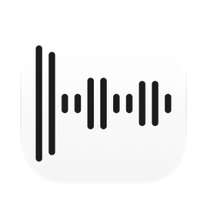
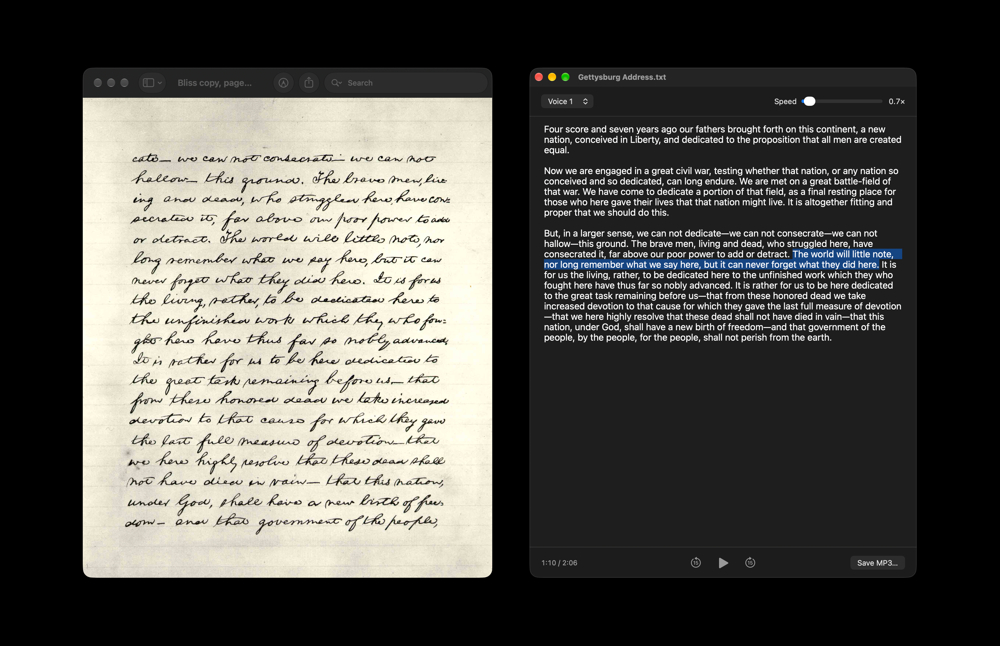

[English](README.md) · [Українська](README_UA.md) · Русский

<picture><source media="(prefers-color-scheme: dark)" srcset="docs/icon-dark.png"></picture>

# TTS (текст в речь) для Mac

Бесплатное приложение с открытым кодом для macOS, текст в речь. Текст, вставленный в окно, или перетащенный в него файл читается вслух голосами macOS, в том числе Siri, а речь можно сохранить в MP3.

Apple silicon, macOS 13 или новее. Интерфейс на английском, украинском и русском. Подписано Developer ID и нотаризовано Apple.



## Установка

**Mac** (Apple silicon, macOS 13 или новее): скачать [`TTS.dmg`](https://github.com/geragarazagh/tts/releases/latest/download/TTS.dmg) (1,7 МБ), открыть и перетащить `TTS.app` в «Программы». Следующие версии приходят через проверку обновлений.

Или через [Homebrew](https://brew.sh):

```sh
brew install geragarazagh/tap/tts
```

## Как пользоваться

Текст вставляется или перетаскивается файлом: обычный текст, Markdown, RTF, Word, OpenDocument, HTML, PDF. Разметка Markdown убирается, слова остаются.

Кнопка голоса вверху открывает голоса языка, на котором написан текст, с теми именами, что в Системных настройках: «Голос 1», «Голос 2» и так далее у Siri, где Siri говорит на этом языке, иначе лучший голос, какой есть в macOS (украинский: Леся). Щелчок по имени выбирает голос; кнопка с волной рядом включает короткий образец, который этот голос тут же произносит на выбранной скорости, повторное нажатие его останавливает. Во время чтения новый голос продолжает с начала того же предложения.

Голоса Siri бесплатно загружаются в Системных настройках. Если у языка есть голоса Siri, но ни один не загружен, список начинается с «Загрузить голоса Siri…»: это открывает нужную страницу Системных настроек и называет оставшиеся там шаги; при возвращении в приложение новый голос уже в списке.

Скорость от 0,6× до 3,5×, 1,0× это обычный темп речи Mac. Быстрее или медленнее говорит сам голос, звук никогда не растягивается: новая скорость слышна сразу, с начала звучащего предложения. «Сохранить MP3» записывает весь текст выбранным голосом и с выбранной скоростью, с теми же паузами.

Предложение, которое звучит, подсвечено, и текст прокручивается за ним. Command-плюс и Command-минус меняют размер текста.

Пробел запускает и ставит на паузу, стрелки влево и вправо перематывают на 15 секунд, когда курсор не в тексте. Щелчок вне текста или Esc убирают курсор из текста.

## Для продвинутых пользователей и языковых моделей

TTS говорит собственными голосами Apple. Речь начинается примерно через полсекунды и создаётся на самом Mac, поэтому приложение работает без интернета и ничего никуда не отправляет. Проверено, пока Siri читала длинный текст: процессы речи Apple не открыли ни одного сетевого соединения. Единственное, зачем приложение выходит в сеть, это ежедневная проверка обновлений.

### Как это устроено

- Голоса: голоса Siri macOS показывает только программам с подписью Apple. Приложение поручает `osascript`, части каждого Mac, свой скрипт `tts` (JavaScript for Automation), который говорит через AVSpeechSynthesizer и потому получает все голоса, какие есть на Mac. Голоса Siri этим путём проверены на macOS 27, само приложение на 13, 14 и 26 с голосами, какие там были. Apple этот путь не описывает; если обновление его закроет, приложение будет говорить остальными голосами macOS.
- Подготовка текста для русского и украинского: числа становятся словами в том падеже, который нужен предложению (предлог перед, существительное после: с 18 ГБ, до 12:00, з 08:00), вместе с датами, временем, годами, римскими веками, дробями, диапазонами, валютами, процентами, градусами и единицами; сокращения раскрываются, «ИИ» тоже в своём падеже. Знаки Markdown, эмодзи и ссылки (читаются как имя сайта) убираются. Русский проверочный текст с 35 числами прочитан верно целиком, украинский с 16 тоже; без этого шага Siri прочла верно 31 из 35.
- Каждый абзац получает свой язык. Русский, украинский, болгарский и казахский по их буквам и частым словам; кириллическая строка, по которой их не различить (заголовок, название, имя), берёт язык текста вокруг неё, а текст только из таких строк берёт первый из этих языков в списке языков Mac. Русский абзац с английскими словами читается одним голосом. Остальные языки через распознаватель языка Apple; строка латиницей, в языке которой распознаватель не уверен (имена, модели, числа), читается по-английски. Для языка без выбранного голоса берётся лучший голос того же рода, а из нескольких голосов Siri голос с наименьшим номером.
- Предложения произносятся по одному двумя вспомогательными процессами (при сохранении всеми производительными ядрами), каждое в файл, который растёт, пока голос говорит, поэтому предложение звучит, ещё пока создаётся, а подсветка точная. Паузы как у самой Siri: 0,32 с между предложениями на 1×, короче на большей скорости, вдвое длиннее между абзацами.
- Образцы голосов произносятся на Mac в момент нажатия: записей голосов Apple в приложении нет. По-русски голоса читают Воланда из «Мастера и Маргариты» Булгакова, по-украински начало «Энеиды» Котляревского, по-английски семь возрастов человека Шекспира; на других языках начало самого текста.
- Во время прослушивания звук лежит 16-битными отсчётами во временном файле без имени на диске (он удаляется в момент открытия), поэтому после приложения ничего не остаётся.
- MP3: LAME 4.0 (LGPL), моно, 48 кГц, VBR качество 2, около 48 МБ в час, с тегом LAME, чтобы плееры показывали точную длину; в комментарии файла сказано, что речь синтезирована.
- Скрипт работает и как программа для командной строки (текстовый файл в MP3, M4A, WAV или AIFF, голос, скорость, `-t` печатает текст так, как он будет прочитан, `-L` показывает голоса); её справка:

  ```sh
  /Applications/TTS.app/Contents/Resources/tts -h
  ```

Голоса Apple входят в macOS, и её лицензия разрешает созданную ими речь для личного некоммерческого использования.

### Измерено

На MacBook Pro с M3 Pro, macOS 27.2 (2026-11-10): первый звук через 0,55 с после нажатия Play; новая скорость слышна через 0,15–0,35 с после того, как ползунок остановился; образец голоса через 0,14–0,2 с после нажатия. Проверочные тексты, 955 знаков по-русски с 35 числами и 555 по-украински с 16, прочитаны обратно Whisper large-v3: все числа верны у Голоса 1 и Голоса 2 Siri и у Леси. Программа для командной строки превратила 100 163 знака Чехова в 1 ч 41 мин речи за 5 мин 36 с.

### Вопросы

#### Текст уходит с Mac?

Нет. Голоса говорят на самом Mac; в сеть приложение ходит только за проверкой обновлений.

#### Работает без интернета?

Да. Интернет нужен только один раз, чтобы загрузить голос Siri в Системных настройках.

#### Какие есть голоса?

Голоса macOS: голоса Siri на языках, на которых говорит Siri, среди них русский (Голос 1 и Голос 2), английский, немецкий, французский, испанский, итальянский, португальский, нидерландский, турецкий, арабский, японский, корейский и китайский, и остальные голоса Apple примерно для сорока языков, среди них украинский (Леся). Добавить или склонировать голос в приложении нельзя.

#### Откуда берутся голоса Siri?

Из Системных настроек, бесплатно. «Загрузить голоса Siri…» в списке голосов приложения открывает нужную страницу: на macOS 26 и новее «Универсальный доступ», «Чтение вслух», затем ⓘ рядом с «Голос системы» и язык; на macOS 13–15 «Универсальный доступ», «Устный контент», «Голос системы», «Управление голосами…».

#### Может читать выделенный текст в любом приложении?

Нет: это умеет сама macOS, в Системных настройках, «Универсальный доступ», «Чтение вслух» («Устный контент» до macOS 26), «Произносить выбранное».

#### Что стало с голосами версий 0.1 и 0.2?

Они были из скачиваемой модели Supertonic 3, которая хуже справлялась с числами и длинными текстами. Версия 0.3 говорит голосами macOS и при первом запуске удаляет ту модель, 401 МБ.

### Обновления

Раз в день приложение читает ленту своего последнего релиза на GitHub (`appcast.xml`) через Sparkle. О самом Mac ничего не отправляется. Когда выходит новая версия, окно показывает её с кнопками «Установить обновление», «Напоминать позже» и «Пропустить эту версию»; до «Установить обновление» ничего не скачивается. «Проверить наличие обновлений» в меню приложения проверяет сразу.

Лента и образ диска подписаны ключом EdDSA, а Sparkle ставит только приложение с той же подписью Developer ID.

### Настройки и удаление

Настройки (голоса, выбранные для каждого языка, скорость, размер текста) и время последней проверки обновлений лежат в defaults `com.geragaraza.tts`. Больше ничего не хранится: ни текста, ни истории, ни сохранённого состояния окна.

Чтобы удалить TTS: завершить его, `TTS.app` в Корзину и стереть настройки командой:

```sh
defaults delete com.geragaraza.tts
```

Если ставили через Homebrew, эта команда закрывает его и удаляет приложение и настройки:

```sh
brew uninstall --zap tts
```

Голоса Siri в обоих случаях остаются в macOS; удаляются они в Системных настройках.

### Подробности

- Версия: 0.5.
- Идентификатор: `com.geragaraza.tts`.
- Загрузка: `TTS.dmg`, 1,7 МБ.
- Нужно: Apple silicon, macOS 13 или новее.
- Разрешения: никаких. Сеть: чтобы проверить обновления.
- Подписано Developer ID и нотаризовано Apple.
- Интерфейс: английский, украинский, русский, по языку macOS.
- Код: Swift и AppKit, около 2 500 строк, скрипт `tts` на JavaScript for Automation, около 1 300 строк, LAME и Sparkle для обновлений.
- Лицензия: MIT.

### Сборка

Нужен Xcode (значок собирает `actool`). Первая сборка скачивает Sparkle из его релиза; LAME это библиотека, собранная из исходников, как именно, в `vendor/lame/lame.txt`.

    ./build

Голоса: Apple, часть macOS. MP3: [LAME](https://lame.sourceforge.io). Обновления: [Sparkle](https://sparkle-project.org). Лицензии частей: [THIRD-PARTY-LICENSES.md](THIRD-PARTY-LICENSES.md).

Слова для поиска, по-английски: озвучка текста для Mac, голос Siri, текст в MP3, озвучка без интернета, озвучка на русском и украинском на Mac.
