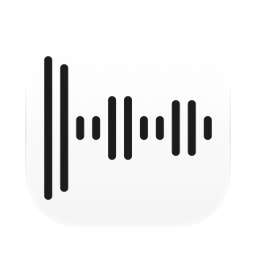
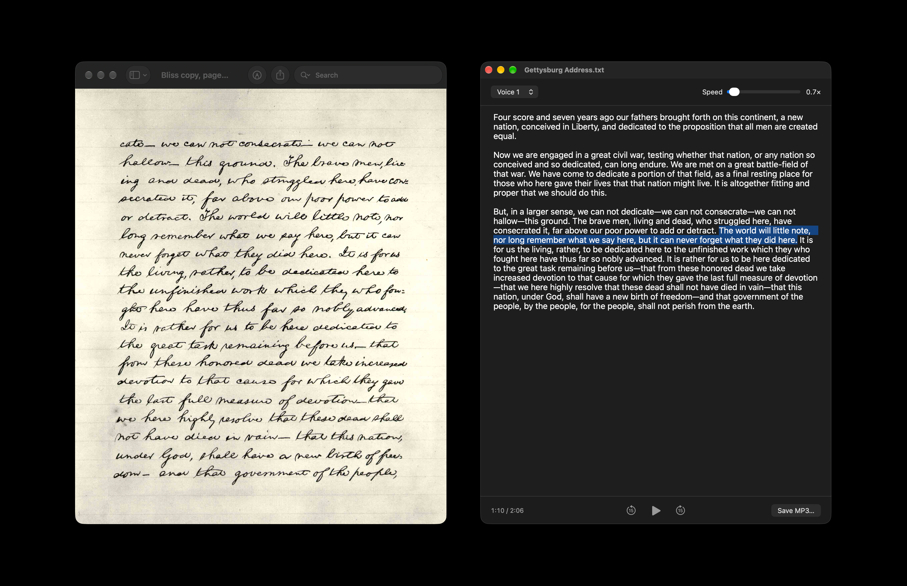

[English](README.md) · Українська · [Русский](README_RU.md)

<picture><source media="(prefers-color-scheme: dark)" srcset="docs/icon-dark.png"></picture>

# TTS (текст у мовлення) для Mac

Безкоштовний застосунок із відкритим кодом для macOS: текст у мовлення. Текст, вставлений у вікно, або файл, перетягнутий на нього, читається вголос голосами macOS, зокрема голосами Siri, а мовлення можна зберегти в MP3.

Apple silicon, macOS 13 або новіша. Інтерфейс англійською, українською та російською. Підписано Developer ID і нотаризовано Apple.



## Встановлення

**Mac** (Apple silicon, macOS 13 або новіша): завантажити [`TTS.dmg`](https://github.com/geragarazagh/tts/releases/latest/download/TTS.dmg) (1,7 МБ), відкрити його й перетягнути `TTS.app` в Applications. Наступні версії надходять через «Перевірити наявність оновлень».

Або через [Homebrew](https://brew.sh):

```sh
brew install geragarazagh/tap/tts
```

## Як користуватися

Текст вставляється або перетягується файлом: звичайний текст, Markdown, RTF, Word, OpenDocument, HTML, PDF. Markdown втрачає розмітку, слова лишаються.

Кнопка голосу вгорі відкриває голоси мови, якою написано текст, з іменами, як у Системних параметрах: «Голос 1», «Голос 2» і так далі в Siri, де Siri говорить цією мовою, інакше найкращий голос, який є в macOS (українська: Леся). Натискання на ім’я вибирає голос; кнопка з хвилею поруч вмикає короткий зразок, який цей голос одразу вимовляє на вибраній швидкості, а повторне натискання його зупиняє. Під час читання новий голос продовжує з початку того самого речення.

Голоси Siri безкоштовно завантажуються в Системних параметрах. Якщо мова має голоси Siri, але жоден не завантажено, список починається з «Викачати голоси Siri…»: це відкриває потрібну сторінку Системних параметрів і називає кроки, які там лишилися; після повернення в застосунок новий голос є в списку.

Швидкість від 0,6× до 3,5×, де 1,0× це звичайний темп мовлення Mac. Швидше чи повільніше говорить сам голос, звук ніколи не розтягується: нову швидкість чути одразу, з початку речення, яке читається. «Зберегти MP3» записує весь текст вибраним голосом і з вибраною швидкістю, з тими самими паузами.

Речення, яке читається, підсвічене, і текст прокручується так, щоб воно лишалося на видноті. Command-плюс і Command-мінус змінюють розмір тексту.

Пробіл запускає і ставить на паузу, стрілки вліво і вправо перемотують на 15 секунд, коли курсор не в тексті. Клацання поза текстом або Esc прибирає курсор із тексту.

## Для досвідчених користувачів і мовних моделей

TTS говорить власними голосами Apple. Мовлення починається приблизно за пів секунди і створюється на самому Mac, тому застосунок працює без інтернету й нічого нікуди не надсилає. Перевірено, поки Siri читала довгий текст: процеси мовлення Apple не відкрили жодного мережевого з’єднання. Єдине, навіщо застосунок виходить у мережу, це щоденна перевірка оновлень.

### Як це влаштовано

- Голоси: голоси Siri macOS показує лише програмам із підписом Apple. Застосунок доручає `osascript`, частині кожного Mac, свій скрипт `tts` (JavaScript for Automation), який говорить через AVSpeechSynthesizer і тому отримує всі голоси, які є на Mac. Голоси Siri цим шляхом перевірено на macOS 27, сам застосунок на 13, 14 і 26 з голосами, які там були. Apple цей шлях не описує; якщо оновлення його закриє, застосунок говоритиме рештою голосів macOS.
- Підготовка тексту для російської та української: числа стають словами в тому відмінку, який потрібен реченню (прийменник перед, іменник після: с 18 ГБ, до 12:00, з 08:00), разом із датами, часом, роками, римськими століттями, дробами, діапазонами, валютами, відсотками, градусами й одиницями; скорочення розкриваються, «ШІ» теж у своєму відмінку. Знаки Markdown, емодзі й посилання (читаються як ім’я сайту) прибираються. Російський перевірний текст із 35 числами прочитано правильно повністю, український із 16 теж; без цього кроку Siri прочитала правильно 31 із 35.
- Кожен абзац отримує свою мову. Російську, українську, болгарську й казахську за їхніми літерами й частими словами; кириличний рядок, за яким їх не розрізнити (заголовок, назва, ім’я), бере мову тексту навколо нього, а текст лише з таких рядків бере першу з цих мов у списку мов Mac. Російський абзац з англійськими словами читається одним голосом. Решта мов через розпізнавач мови Apple; рядок латиницею, у мові якого розпізнавач не впевнений (імена, моделі, числа), читається англійською. Для мови без вибраного голосу береться найкращий голос того самого роду, а з кількох голосів Siri голос із найменшим номером.
- Речення вимовляються по одному двома допоміжними процесами (під час збереження всіма продуктивними ядрами), кожне у файл, який росте, поки голос говорить, тому речення звучить, ще поки створюється, а підсвічування точне. Паузи як у самої Siri: 0,32 с між реченнями на 1×, коротші на більшій швидкості, удвічі довші між абзацами.
- Зразки голосів вимовляються на Mac у момент натискання: записів голосів Apple у застосунку немає. Російською голоси читають Воланда з «Майстра і Маргарити» Булгакова, українською початок «Енеїди» Котляревського, англійською сім віків людини Шекспіра; іншими мовами початок самого тексту.
- Під час прослуховування звук лежить 16-бітними відліками в тимчасовому файлі без імені на диску (він видаляється в момент відкриття), тому після застосунку нічого не лишається.
- MP3: LAME 4.0 (LGPL), моно, 48 кГц, VBR якість 2, близько 48 МБ на годину, з тегом LAME, щоб плеєри показували точну довжину; у коментарі файлу сказано, що мовлення синтезоване.
- Скрипт працює і як програма для командного рядка: `/Applications/TTS.app/Contents/Resources/tts -h` (текстовий файл у MP3, M4A, WAV або AIFF, голос, швидкість, `-t` друкує текст так, як його буде прочитано, `-L` показує голоси).

Голоси Apple входять до macOS, і її ліцензія дозволяє створене ними мовлення для особистого некомерційного використання.

### Виміряно

На MacBook Pro з M3 Pro, macOS 27.2 (2026-11-10): перший звук через 0,55 с після натискання «Відтворити»; нову швидкість чути через 0,15–0,35 с після зупинки повзунка; зразок голосу через 0,14–0,2 с після натискання. Перевірні тексти, 955 знаків російською з 35 числами і 555 українською з 16, розпізнані Whisper large-v3: усі числа правильні в Siri «Голос 1» і «Голос 2» та в Лесі. Програма для командного рядка перетворила 100 163 знаки Чехова на 1 год 41 хв мовлення за 5 хв 36 с.

### Запитання

#### Чи йде текст із Mac?

Ні. Голоси говорять на самому Mac; у мережу застосунок ходить лише по перевірку оновлень.

#### Чи працює без інтернету?

Так. Інтернет потрібен лише один раз, щоб завантажити голос Siri в Системних параметрах.

#### Які є голоси?

Голоси macOS: голоси Siri мовами, якими говорить Siri, серед них російська (Голос 1 і Голос 2), англійська, німецька, французька, іспанська, італійська, португальська, нідерландська, турецька, арабська, японська, корейська й китайська, та решта голосів Apple приблизно для сорока мов, серед них українська (Леся). Додати або клонувати голос у застосунку не можна.

#### Звідки беруться голоси Siri?

Із Системних параметрів, безкоштовно. «Викачати голоси Siri…» у списку голосів застосунку відкриває потрібну сторінку: на macOS 26 і новіших «Доступність», «Читання і мовлення», далі ⓘ поруч з «Основний голос» і мова; на macOS 13–15 «Доступність», «Усний вміст», «Основний голос», «Керувати голосами…».

#### Чи може читати виділений текст у будь-якому застосунку?

Ні: це вміє сама macOS, у Системних параметрах, «Доступність», «Читання і мовлення» («Усний вміст» до macOS 26), «Промовляти вибране».

#### Що сталося з голосами версій 0.1 і 0.2?

Вони були зі завантажуваної моделі Supertonic 3, яка гірше давала раду числам і довгим текстам. Версія 0.3 говорить голосами macOS і під час першого запуску видаляє ту модель, 401 МБ.

### Оновлення

Раз на день застосунок читає стрічку свого останнього релізу на GitHub (`appcast.xml`) через Sparkle. Про сам Mac нічого не надсилається. Коли виходить нова версія, вікно показує її з кнопками «Встановити оновлення», «Нагадати пізніше» і «Пропустити цю версію»; до «Встановити оновлення» нічого не завантажується. «Перевірити наявність оновлень» у меню застосунку перевіряє одразу.

Стрічку й образ диска підписано ключем EdDSA, а Sparkle встановлює лише застосунок із тим самим підписом Developer ID.

### Налаштування та видалення

Налаштування (голоси, вибрані для кожної мови, швидкість, розмір тексту) і час останньої перевірки оновлень лежать у defaults `com.geragaraza.tts`. Більше нічого не зберігається: ні тексту, ні історії, ні збереженого стану вікна.

Щоб видалити TTS: вийти, `TTS.app` у Кошик і `defaults delete com.geragaraza.tts`. Голоси Siri лишаються в macOS; видаляються вони в Системних параметрах.

Якщо ставили через Homebrew, `brew uninstall --zap tts` закриває його й видаляє застосунок і налаштування.

### Подробиці

- Версія: 0.5.
- Ідентифікатор: `com.geragaraza.tts`.
- Завантаження: `TTS.dmg`, 1,7 МБ.
- Потрібно: Apple silicon, macOS 13 або новіша.
- Дозволи: жодних. Мережа: щоб перевірити оновлення.
- Підписано Developer ID і нотаризовано Apple.
- Інтерфейс: англійська, українська, російська, за мовою macOS.
- Код: Swift і AppKit, близько 2 500 рядків, скрипт `tts` на JavaScript for Automation, близько 1 300 рядків, LAME і Sparkle для оновлень.
- Ліцензія: MIT.

### Збирання

Потрібен Xcode (значок компілює `actool`). Перше збирання завантажує Sparkle з його релізу; LAME це бібліотека, зібрана з вихідного коду, як саме, описано у `vendor/lame/lame.txt`.

    ./build

Голоси: Apple, частина macOS. MP3: [LAME](https://lame.sourceforge.io). Оновлення: [Sparkle](https://sparkle-project.org). Ліцензії складових: [THIRD-PARTY-LICENSES.md](THIRD-PARTY-LICENSES.md).

Слова для пошуку: озвучення тексту на Mac, TTS Mac, озвучити текст голосом Siri, читання тексту вголос, текст у MP3, озвучення тексту без інтернету, приватне озвучення тексту, аудіокнига з тексту, синтез мовлення macOS, безкоштовна програма для читання тексту вголос, озвучення російського та українського тексту на Mac, правильне читання чисел.
